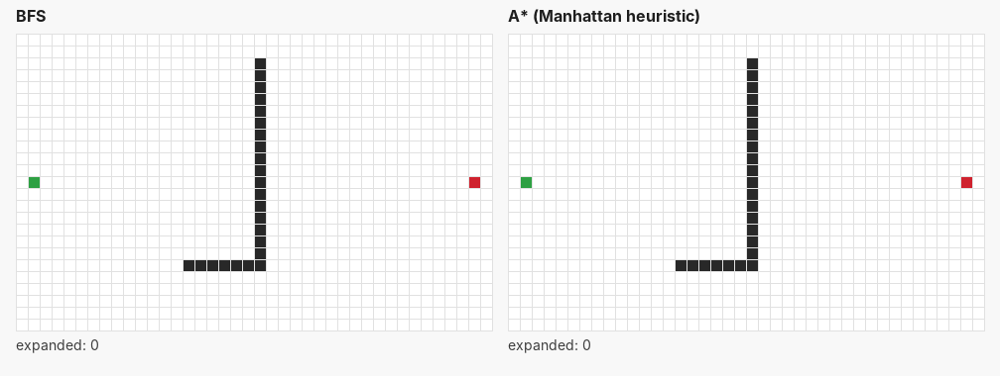

# Path Planning Visualizer

An interactive Java (Swing) tool that animates grid pathfinding step by step and compares how efficiently different search algorithms find the shortest path.



*Same map, same start (green) and goal (red). BFS spreads out in every direction; A\* heads toward the goal and expands about a third as many cells to find a path of the same length.*

## Features

- **Three search algorithms:** breadth-first search, Dijkstra's algorithm, and A\* with a Manhattan-distance heuristic
- **Step-by-step animation:** expanded cells (blue), the frontier (green), and the final path (yellow)
- **Live stats:** nodes expanded, path length, and search runtime
- **Editable maps:** draw and erase walls, move the start and goal

## Results

On the map in the demo above (25 x 40 grid):

| Algorithm | Path length | Cells expanded |
|---|---|---|
| BFS | 53 | 959 |
| A\* | 53 | 332 |

Both find a shortest path, but A\* expands about 65% fewer cells. Dijkstra's algorithm behaves almost exactly like BFS here, because every move on this grid costs 1; it only pulls ahead when moves have different costs.

## How it works

- **`PathFinder` interface:** every algorithm advances one cell per `step()` call, which lets the UI animate any of them with the same timer loop.
- **BFS:** a FIFO queue. Cells are marked as discovered when they are queued, not when they are expanded, so each cell enters the queue at most once.
- **A\*:** a priority queue ordered by f = g + h, where g is the steps taken so far and h is the Manhattan distance to the goal. Because the heuristic never overestimates, the path found is still a shortest path. Java's `PriorityQueue` cannot lower an entry's priority, so a cell reached by a shorter route is added again, and stale copies are skipped when they reach the front (lazy deletion). Ties in f are broken toward larger g, which keeps the search pointed at the goal.
- **Dijkstra:** a subclass of `AStar` that overrides the heuristic to return 0, so it expands purely by distance from the start.

## Running it

Requires Java 17 or newer.

**IntelliJ IDEA:** open the project and run `src/Main.java`.

**Command line**, from the project folder:

```
javac -d out src/*.java src/algo/*.java src/model/*.java src/ui/*.java
java -cp out Main
```

## Controls

| Action | Input |
|---|---|
| Draw walls | Left-click and drag |
| Erase walls | Right-click and drag |
| Move the start | Shift + click |
| Move the goal | Ctrl + click |
| Run a search | Choose an algorithm, then **Run** |

## Roadmap

- Weighted terrain, so Dijkstra and A\* can be compared against BFS on non-uniform costs
- Planning on general graphs instead of grids, including probabilistic roadmaps (PRM) with a straight-line-distance heuristic
- JUnit tests for the grid and each search algorithm
